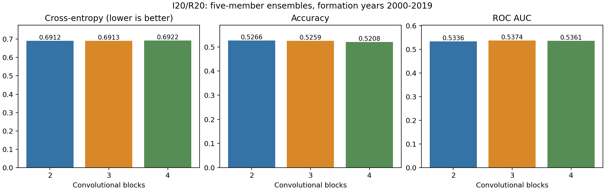
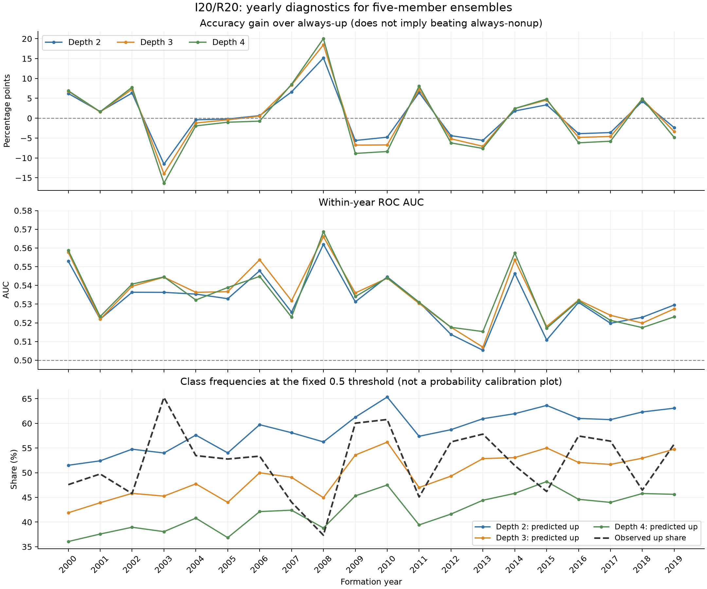

# CNN Price Trends Replication

《(Re-)Imag(in)ing Price Trends》的课程复现实验：输入过去 20 个交易日的价格图像，预测随后 20 个交易日收益是否为正（I20/R20）。主实验使用三层 CNN；扩展包括二／四层结构敏感性分析及 Grad-CAM 可视化。

本目录整理实际执行代码、核心环境版本、运行记录、结果表和图片。实验已完成，整理日期为 2026-11-19。课程数据划分优先于原论文设置，因此属于课程设定下的方法复现，不声称完整重现论文全部实证。

## 结果概览

主区间为 2000—2019 年，分类有效样本 1,490,937 个；每种结构使用五个成员的等权平均上涨概率。

|结构|每成员参数量|CE ↓|Accuracy ↑|MCC ↑|AUC ↑|EW H-L Sharpe|VW H-L Sharpe|
|---|---:|---:|---:|---:|---:|---:|---:|
|二层|201,218|0.691202|52.657%|0.0474|0.5336|1.550|0.337|
|三层|708,866|0.691295|52.587%|0.0524|0.5374|1.701|0.487|
|四层|2,707,202|0.692228|52.079%|0.0485|0.5361|1.727|0.406|

二层具有较低 CE、较高 Accuracy 和较少参数；三层的 AUC、MCC 和 VW Sharpe 较高；四层仅 EW Sharpe 略高。没有跨指标一致占优的结构。以上为描述性结果，未作统计显著性判断。Always-up 主区间准确率为 51.914%。

金融评价使用 `Ret_month`，分类标签使用 `Ret_20d`。金融结果为未扣交易成本、零无风险利率假设下的历史完整观测样本比较。课程主区间包含 239 个有效形成月份；2019 年最后一个月缺少可用后续收益。年度金融分析按形成年份归属。

## 阅读入口

|内容|位置|
|---|---|
|从新数据开始运行|[复现步骤](docs/reproduction_zh.md)|
|数据、结构、训练与评价口径|[方法说明](docs/methods_zh.md)|
|实际运行时间及故障处理|[运行记录说明](docs/execution_zh.md)|
|脚本职责|[代码索引](docs/code_index_zh.md)|
|完整结果解释|[结果复核](docs/results_review_zh.md)|
|逐年结果解释|[年度分析](docs/yearly_analysis_zh.md)|
|正文、附录和结论所用文件|[结果文件索引](docs/file_index_zh.md)|
|核心版本与安装范围|[环境说明](environment/README.md)|
|论文、代码来源及 AI 使用|[来源与使用说明](docs/sources_and_ai_zh.md)|

## 主要图表





Grad-CAM 图位于 [results/gradcam](results/gradcam)，包含 12 个案例及 72 份热图数组。样本来自固定验证集；每个案例并排展示二、三、四层结构对两个类别的解释。它解释固定 seed 101 成员，不是五成员融合解释。

## 快速使用

以下命令均在仓库根目录执行。仅查看已提交的结果无需 GPU、模型权重或原始数据。

```powershell
# 查看流程，不启动训练
python scripts/reproduce.py plan

# 使用 NumPy、pandas 复核已提交的汇总结果
python scripts/review_recorded_results.py

# 检查整理目录中的文件完整性
python scripts/verify_submission.py
```

从头训练需按[环境说明](environment/README.md)安装依赖，并按[数据说明](data/README.md)准备数据。新实验写入 `runs/`，与已经完成的 `records/` 和 `results/` 分开保存。

```powershell
python scripts/reproduce.py all --data-dir "D:/data/monthly_20d" --run-root "runs/reproduction_01"
```

训练共 15 个成员；原设备记录训练耗时合计约 18.22 小时，未包括全部推理、分析、人工暂停和整理时间。实际耗时取决于设备。新运行入口在整理时补充，已作配置绑定与流程检查；未在整理期间重新执行完整 GPU 训练。

## 文件范围

- `code/`：实际执行的训练、测试、扩展及恢复代码；原 Python 文件保留字节级副本。
- `scripts/`：整理后增加的统一入口、数据检查和结果复核工具。
- `environment/`：实际记录的核心版本及重建说明。
- `records/`：历史日志、环境记录、划分统计、完成记录及文件指纹。
- `results/`：分类、金融、训练成本、校准与 Grad-CAM 表格及图片。
- `analysis/`：年度分析表、图片及重绘脚本。
- `protocols/`：测试前声明的实验规则。

原始数据、模型权重、逐图预测、特征缓存和环境本体不包含在公开目录。历史记录保留原 Windows 路径和大文件指纹，用于说明已执行实验，不是可直接恢复的完整运行目录。数据与权重缺失时，不能凭这些记录恢复旧训练；可按入口重新生成新实验。

所有文件名采用 ASCII 字符；中文文档使用 UTF-8。源文件指纹见 [SOURCE_MANIFEST.json](SOURCE_MANIFEST.json)，整理包清单见 [SUBMISSION_MANIFEST.json](SUBMISSION_MANIFEST.json)。
